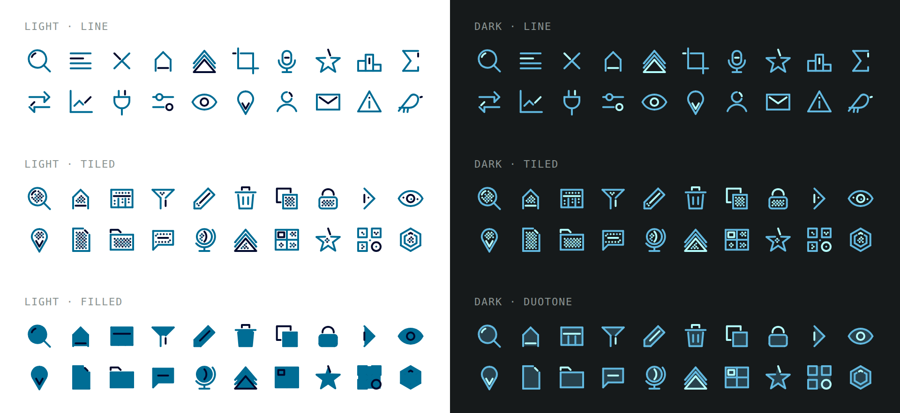
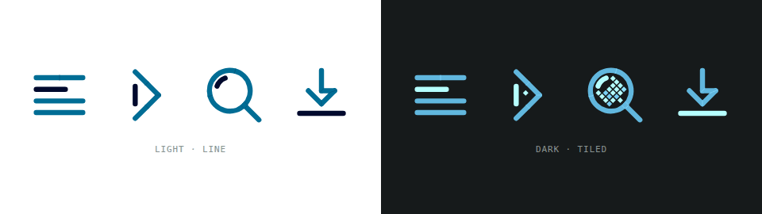

# <picture><source media="(prefers-color-scheme: dark)" srcset=".github/assets/icon-dark.svg"></picture> tesela

[](https://www.npmjs.com/package/tesela)
[](https://bundlejs.com/?q=tesela)
[](LICENSE)

Mosaic-identity icon set: five strokes, a dynamic detail tone, four variants and transitions. Core, React and sprite.



**[Live demo](https://ghegar.github.io/tesela/)**

A mosaic-identity icon set. Every icon is exactly five strokes, each a continuous line that may turn
corners, and one of them is a loose **detail**, computed five tones away from the main color. Icons come in line,
tiled, filled and duotone variants, and morph into each other: the detail travels, the new brushstroke
draws itself.
Colors derive from `currentColor` with CSS relative color, with a `color-mix` fallback, so an icon takes
the color of its text and needs no stylesheet.

## Install

```bash
npm install tesela
```

| Entry | What it is | Needs |
|---|---|---|
| `tesela` | Framework-free core: 98 icon definitions, geometry, rules, `renderIcon` to SVG strings | nothing |
| `tesela/react` | One component per icon, `Icon` by name and `IconTransition` | `react >= 19` |
| `tesela/sprite.svg` | SVG sprite with a `<symbol>` per icon and per tiled, filled and duotone icon | nothing |

## Quick start

```tsx
import { useState } from 'react';
import { close, menu } from 'tesela';
import { IconTransition, Search } from 'tesela/react';

export function Toolbar() {
    const [open, setOpen] = useState(false);
    return (
        <nav>
            <Search size={20} title="Search" />
            <button type="button" onClick={() => setOpen(!open)}>
                <IconTransition icon={open ? close : menu} title={open ? 'Close' : 'Menu'} />
            </button>
        </nav>
    );
}
```

## Props

| Prop | Default | |
|---|---|---|
| `size` | `24` | Width and height |
| `stroke` | `1.5` | Stroke width, 1 to 2.5 |
| `junta` | `0.5` | Visible gap between the detail and the strokes |
| `variant` | `'line'` | `'line'`, `'tiled'`, `'filled'` or `'duotone'`; icons without a body fall back to line |
| `seams` | `true` | Thin marks where main strokes meet |
| `detailDirection` | inherited | `'darker'` or `'lighter'`; sets `--tesela-dir` |
| `colorMode` | `'auto'` in React, `'relative'` in the core | `'auto'`, `'relative'` or `'mix'`; see Color |
| `title` | — | Accessible name; without it the icon is `aria-hidden` |

The same options go to `renderIcon` in the core. React components also pass any other SVG attribute
(`className`, `style`, `onClick`…) to the `<svg>`.

## Color

The main strokes use `currentColor`. The detail is five tones away from it, the seams two and the tiles
one to five, computed with `oklch(from currentColor …)`, with a `color-mix` fallback in the presentation
attribute.

`colorMode` picks how:

- `'relative'` writes both; a browser that can't parse the relative color keeps the fallback.
- `'mix'` writes only the `color-mix` fallback, towards white when `detailDirection` is `'lighter'`.
- `'auto'` (React's default) measures once in the DOM whether the browser really derives a color from
  `currentColor`, not only whether it parses the syntax, and picks `'relative'` or `'mix'`.
  `supportsRelativeColor()` exposes the same check.

The detail goes darker by default. For dark themes set `--tesela-dir: -1` on any ancestor, or pass
`detailDirection="lighter"`.

```css
@media (prefers-color-scheme: dark) {
    :root { --tesela-dir: -1; }
}
```

## Rules

Every icon passes `validate()`: exactly five strokes, four for the icon and one for the detail, each a
continuous line, the detail at least stroke + junta away from every other
stroke, lines at 0, 45 or 90° unless marked, and inside the 24 × 24 box, for strokes from 1 to 2.5 and
juntas from 0.25 to 1.5. A definition may describe its shape in fewer or longer lines; `geometryOf`
splits it into the four strokes that are drawn. When the detail is part of an outline it skips the
corner: the outline keeps the corner and the gap falls on the detail's side.

```ts
import { icons, validate } from 'tesela';

validate(icons);
```

It returns a list of `{ name, problem }`; an empty list means every icon follows the rules.

## Icons

98 icons in eight groups: navigation, actions, status, objects, map, tools, content and the hummingbird. The core exports
each definition in camelCase (`search`, `zoomIn`, `eyeOff`), plus `icons`, `iconNames` and
`getIcon(name)`. React exports one component per icon in PascalCase (`Search`, `ZoomIn`, `EyeOff`).

Three definitions carry a suffix in the core only:

| Core | React | Name |
|---|---|---|
| `documentIcon` | `Document` | `'document'` |
| `downloadIcon` | `Download` | `'download'` |
| `undoIcon` | `Undo` | `'undo'` |

`npm run demo` opens the catalog with every icon, sliders for stroke and junta and the transitions.

## Core

```ts
import { renderIcon, search } from 'tesela';

renderIcon(search, { size: 24, stroke: 1.5, junta: 0.5, variant: 'line', seams: true });
```

`renderIcon` returns an SVG string. `iconParts` returns the same pieces (attributes, tiles, strokes,
seams and detail) for renderers of your own, and `resolveIcon` the raw geometry for a stroke and junta.

## React

```tsx
import { Icon, Search } from 'tesela/react';

<Search size={20} title="Search" />
<Search variant="tiled" stroke={2} />
<Icon name="search" />
```

`Icon` renders nothing when the name is unknown.

### Transitions



```tsx
<IconTransition icon={open ? close : menu} duration={560} />
```

`IconTransition` takes an icon definition and every icon prop. When `icon` changes, the detail travels
to its new position, strokes the two icons share stay, the old ones fade and the new ones are drawn in
brushstroke order. `duration` is in milliseconds, `560` by default. With `prefers-reduced-motion: reduce`
the icon swaps without animation.

## Sprite

```html
<svg width="24" height="24"><use href="tesela/sprite.svg#search" /></svg>
<svg width="24" height="24"><use href="tesela/sprite.svg#search-tiled" /></svg>
```

Serve `dist/sprite.svg` with your assets and point `href` at it. Symbols use the default options
(stroke 1.5, junta 0.5, seams on); `-tiled`, `-filled` and `-duotone` symbols exist only for icons with
a body.

## Known limitations

- Relative color has been checked in Chrome and Firefox; Safari relies on `colorMode: 'auto'`.
- The sprite is fixed at the default stroke and junta. For other values use the core or React.
- Filled, duotone and tiled need a closed body; open icons (close, menu, chevrons…) stay as lines.

## Development

```bash
npm test
npm run lint
npm run typecheck
npm run build
npm run demo
```

The demo is the catalog: every icon with controls for stroke, junta, variant, seams, size and color,
the result of `validate`, and the transitions between icons and between pairs.

## Contributing

Issues are welcome. Open one before sending a pull request.

## License

AGPL-3.0-only © GHEgar
